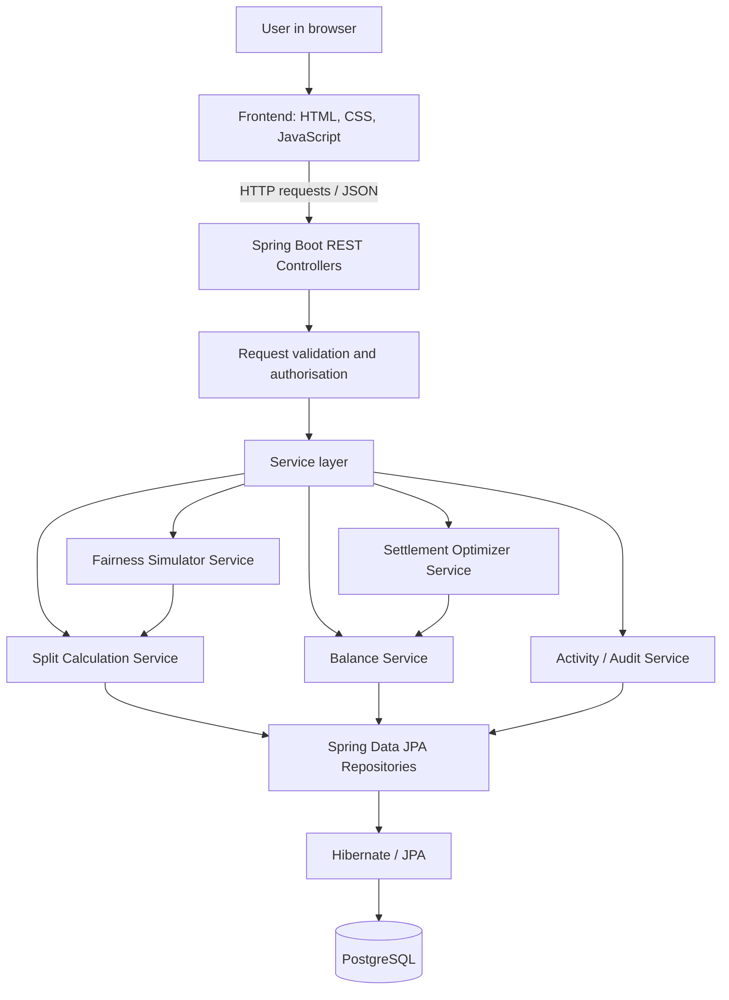
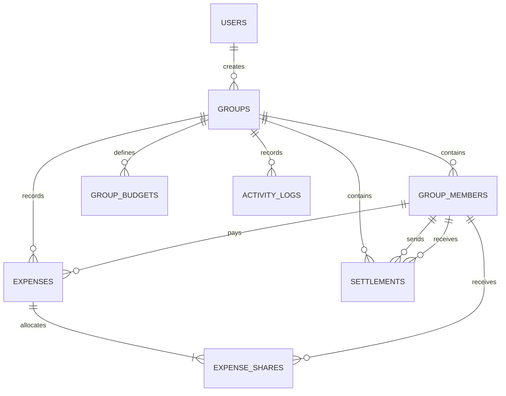
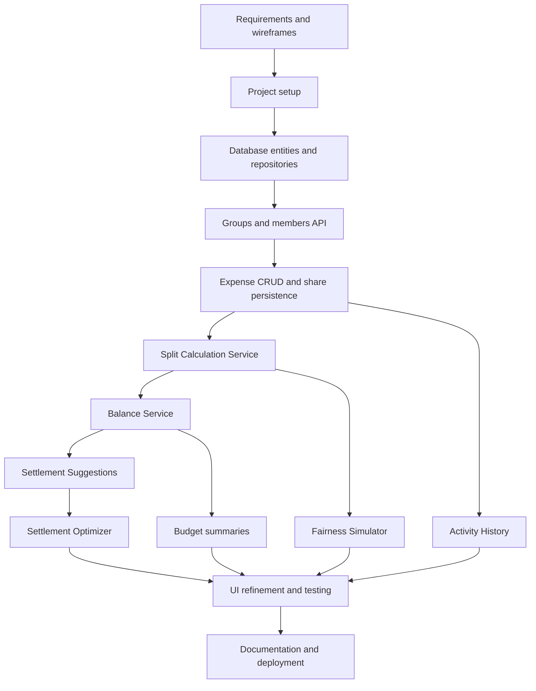

# Expense Splitter with FairShare Intelligence

**Project specification and implementation blueprint**  
**Presenter / project owner:** Tulsi  
**Project category:** Full-stack web application  
**Primary audience:** College project evaluation  
**Current status:** Planned specification — features described here are intended implementation, not a claim that they have already been built.

---

## 1. Executive Summary

**Expense Splitter with FairShare Intelligence** is a web application for recording shared expenses, calculating each group member's financial position, and suggesting how outstanding debts can be settled. It is designed for situations such as college trips, hostel life, shared meals, project teams, events, and other group activities.

A conventional expense splitter usually records payments and reports who owes whom. FairShare Intelligence adds a transparent decision-support layer: users can preview alternative split arrangements, understand why each member owes or is owed a particular amount, and compare settlement plans before accepting one.

The application will combine:

- Group and member management.
- Expense creation, editing, and deletion.
- Equal, exact-amount, percentage, and participant-based splits.
- Persistent data stored in PostgreSQL through a Java backend.
- Net balance calculation and settlement suggestions.
- **Fairness Simulator:** preview and compare different expense-splitting scenarios before saving.
- **Settlement Optimizer:** generate payment plans that reduce the number of transfers; use exact optimisation for manageable group sizes and a documented fallback for larger groups.
- **Explainable Expense History:** show the reasons behind balance changes and maintain a traceable activity record.
- **Group Budget Radar:** optional budget tracking, threshold alerts, and spending summaries.

The core will be built with HTML, CSS, JavaScript, Java, Spring Boot, and PostgreSQL. The system will use REST APIs, a layered backend architecture, validation, and automated tests for its financial calculations.

> **Important principle:** The application does not decide what is morally “fair.” It makes alternative rules visible, calculates their consequences, and allows the group to select and confirm the arrangement it considers appropriate.

## 2. Problem Statement

Groups often share costs unevenly. One person may pay for everyone, not every member may participate in each activity, and different expenses may need different split rules. Tracking these payments manually creates several problems:

1. People can lose track of who paid for which expense.
2. Equal division is not always appropriate when participation differs.
3. Recalculating balances after editing or deleting an expense is error-prone.
4. Multiple overlapping debts can produce many unnecessary payment transfers.
5. Group members may not understand how a final balance was calculated.
6. A group can lose track of spending against its budget.

The project addresses these issues through a central record of expenses, deterministic money calculations, transparent split previews, and settlement suggestions.

## 3. Project Objectives

### 3.1 Primary objectives

- Make it easy to create groups and manage group members.
- Record each expense with its description, amount, payer, date, and participating members.
- Support multiple split methods and ensure the resulting shares add up exactly to the expense amount.
- Calculate each member's net balance consistently.
- Show clearly who owes whom and how much.
- Store data in a persistent relational database.
- Provide a responsive interface that works on laptop and mobile screens.
- Make the calculation rules understandable and testable.

### 3.2 Differentiation objectives

- Let users experiment with alternative split rules without changing saved data.
- Compare proposed shares with the existing shares.
- Explain changes in a member's balance in understandable language.
- Reduce the number of payments required to settle a group, where feasible.
- Help groups track their spending against a chosen budget.

### 3.3 Engineering objectives

- Use a clear separation between frontend, API controllers, business services, data access, and database entities.
- Keep money arithmetic out of the presentation layer.
- Make important calculation rules independently unit-testable.
- Validate input on the server, not only in the browser.
- Preserve consistency when an expense and its individual shares are saved or updated.
- Document how to install, run, test, and deploy the application.

## 4. Intended Users and Use Cases

### 4.1 Target users

- College students sharing hostel or trip expenses.
- Friends splitting meals, tickets, transport, or accommodation.
- Project teams sharing costs for events or materials.
- Small groups managing recurring shared costs.

### 4.2 Example use cases

**Use case A — Shared dinner:** One member pays ₹900 for three people. The app assigns the correct share to each participant and calculates the payer's net balance.

**Use case B — Different participation:** Five friends travel together, but only four attend an amusement park. The Fairness Simulator compares splitting the ticket expense across all five people with splitting it across the four participants.

**Use case C — Unequal shares:** A group pays for an accommodation booking. Members agree to pay exact amounts or percentages that reflect their arrangement.

**Use case D — Settlement:** Several members owe money while others are owed money. The Settlement Optimizer proposes transfers that bring the group's outstanding balances to zero.

**Use case E — Budget tracking:** A trip group creates a ₹20,000 budget. The application reports spending progress and warns the group when it reaches configured thresholds, such as 80% or 100%.

## 5. Scope and Delivery Priorities

The project should be developed in layers. The core financial workflows must be correct before advanced features are added.

### 5.1 Core delivery — must work reliably

- Create, view, edit, and delete groups where applicable.
- Add and manage members within a group.
- Add, view, edit, and delete expenses.
- Support equal, exact-amount, and percentage splits.
- Select which members participate in each expense.
- Store expenses and shares in PostgreSQL.
- Calculate net balances and show settlement suggestions.
- Validate all monetary calculations on the backend.
- Provide loading, empty, success, and error states in the UI.
- Test important calculation invariants and edge cases.

### 5.2 Signature FairShare features — main differentiators

1. **Fairness Simulator:** scenario preview, participant selection, split-rule comparison, balance-difference preview, and explicit confirmation before saving.
2. **Settlement Optimizer:** generate a settlement plan that minimises transfers where the selected algorithm can guarantee it, and otherwise provide a clearly labelled practical plan.
3. **Explainable Expense History:** explain balance changes and keep an activity trail of important edits and settlements.

### 5.3 Advanced extensions — add after the core is stable

- User registration and login.
- Secure, shareable group invitation links.
- Group Budget Radar, budget thresholds, categories, and charts.
- CSV export.
- Publicly deployed frontend and backend.
- Improved settlement optimisation for larger groups.
- Optional future features such as receipt attachments or expense-description categorisation.

The current design does **not** require AI, payment-gateway integration, a mobile application, or microservices. Those should not delay the core delivery.

## 6. Technology Stack

### 6.1 Frontend

**Selected technologies:**

- **HTML5:** page structure and semantic forms.
- **CSS3:** layout, responsive styling, visual states, and component appearance.
- **JavaScript (vanilla):** form handling, client-side interactions, dynamic rendering, and REST API requests using the Fetch API.

**Why this choice:** A plain frontend keeps the number of technologies manageable and makes the project suitable for learning and demonstrating core web development concepts. A frontend framework such as React can be considered later, but it is not required for the first version.

**Frontend responsibilities:**

- Display groups, members, expenses, balances, and settlement plans.
- Collect expense details and split configurations.
- Provide interactive previews in the Fairness Simulator.
- Send requests to the backend and display response data.
- Show loading indicators, validation messages, empty states, and API errors.
- Adapt to phone, tablet, and desktop widths.

### 6.2 Backend

**Selected technologies:**

- **Java 21 LTS:** primary backend language and runtime target.
- **Spring Boot:** application framework and REST API runtime.
- **Spring Web:** HTTP endpoints and JSON request/response handling.
- **Spring Data JPA:** repository and persistence abstractions.
- **Hibernate:** JPA implementation that maps Java entities to relational tables.
- **Jakarta Bean Validation:** request and field validation.
- **Maven:** dependency management and build lifecycle.
- **Spring Boot DevTools:** optional development-time convenience.

**Backend responsibilities:**

- Validate all input and enforce group membership constraints.
- Calculate splits and member balances.
- Generate settlement plans.
- Implement the Fairness Simulator's preview calculations.
- Persist records through a transactional data-access layer.
- Return consistent JSON responses and error messages.
- Keep business rules independent of the frontend.

### 6.3 Database

**Selected database: PostgreSQL**

PostgreSQL is suitable because the application has strongly related data: groups have members, expenses belong to groups, shares belong to expenses and members, and settlements connect group members. Relational constraints and transactions help maintain data consistency.

**Supporting tools:**

- **PostgreSQL JDBC Driver:** Java-to-PostgreSQL connectivity.
- **pgAdmin 4:** optional visual database administration.
- **Flyway:** recommended for versioned schema migrations as the project grows. If it is not added initially, document and manage schema changes carefully rather than changing the database silently.

### 6.4 Development and testing tools

| Tool | Purpose |
|---|---|
| IntelliJ IDEA | Write, run, and debug Java/Spring Boot code. |
| JDK 21 | Compile and run the backend. |
| Spring Initializr | Generate the initial Spring Boot project. |
| PostgreSQL / pgAdmin | Run the database and inspect records. |
| Postman | Test REST API endpoints independently of the UI. |
| Browser developer tools | Inspect frontend errors, network requests, and responsive layouts. |
| Git | Track code changes and create checkpoints. |
| GitHub | Host the repository and share the source code. |
| JUnit 5 | Unit-test business logic. |
| Mockito | Isolate service dependencies in unit tests when appropriate. |
| Spring Boot Test | Test Spring components and application integration. |
| Chart.js (optional) | Render spending charts in the advanced version. |

### 6.5 Runtime and deployment

The first version can run locally. For public demonstration, deploy the static frontend and Spring Boot backend to suitable hosting, and use a managed or hosted PostgreSQL database. A provider such as Render is one option, but the final provider should be selected after confirming current Java, database, cost, and free-tier constraints.

Configuration such as database credentials, session secrets, and invite-token signing keys must be supplied through environment variables or the hosting platform's secret configuration. Never commit secrets to GitHub.

## 7. High-Level System Architecture



### 7.1 Architectural principles

- **Thin controllers:** controllers receive requests, validate request shapes, call services, and return responses. Complex calculations do not belong in controllers.
- **Service-based business logic:** split, balance, fairness-preview, and settlement rules live in dedicated Java classes.
- **Repository-based persistence:** data access goes through repositories instead of embedding SQL throughout the application.
- **Transactional updates:** an expense and all associated share rows must be saved or updated together.
- **Server-side authority:** the backend recalculates and validates financial results. It does not trust client-supplied balances.
- **Clear response formats:** endpoints return consistent JSON and useful HTTP status codes.
- **Testability:** the core calculation services should be testable without starting the browser or database.

### 7.2 Typical request lifecycle

1. The user submits a form or selects a simulation option.
2. JavaScript sends a JSON request to the backend.
3. The controller validates the request's structure.
4. The service verifies the business rules and calculates the result.
5. The repository reads or writes the necessary records.
6. The backend returns JSON with the result or a structured error.
7. The frontend updates the interface and presents the result clearly.

## 8. Functional Requirements in Detail

### 8.1 Groups

- Create a group with a name and optional description.
- List groups available to the current user or local workspace.
- View a group's members, expenses, balances, and budget information where available.
- Edit group metadata.
- Delete or archive a group only after handling its dependent records appropriately.
- Keep each expense, member, budget, and settlement linked to the correct group.

For the first prototype, the application can support a simple local workspace without accounts. Once authentication is added, the backend must verify ownership or group membership for every group-scoped operation.

### 8.2 Members

- Add a member using a display name.
- View all members in a group.
- Prevent duplicate or invalid member entries according to a documented rule.
- Prevent an expense from referencing a member from another group.
- Avoid deleting members who are referenced by financial records without a defined archival or migration policy.
- In the authenticated version, link a group-member record to a user account when appropriate, while still allowing a group to contain invited participants who have not yet registered if that feature is desired.

### 8.3 Expenses

Each expense should contain:

- Description.
- Total amount in paise.
- Group ID.
- Payer/member ID.
- Date and time of the expense.
- Split method.
- Optional category.
- Participating members and each participant's share.
- Created and updated timestamps.

Supported operations:

- Create an expense.
- View an expense and the shares that compose it.
- List expenses in a group, with pagination or filtering as the dataset grows.
- Edit an expense's details, payer, participating members, or split rule.
- Delete or archive an expense while recording the activity where audit history is enabled.

The backend must recalculate the relevant shares and balances after edits or deletions. Any recorded settlement remains a historical financial event; it must not be silently rewritten just because the source expense changes. If the change causes a new outstanding balance, show the revised position and allow additional settlement or a properly audited correction.

### 8.4 Split methods

#### A. Equal split

The total amount is divided among the selected participants. Remainder paise are distributed deterministically so that the shares sum exactly to the total.

Example: ₹100.00 split three ways becomes ₹33.34, ₹33.33, and ₹33.33. The application must have a repeatable rule for deciding who receives the extra paise, such as stable member ordering or a deterministic participant order.

#### B. Exact-amount split

The user enters the amount owed by each participant. The backend validates that:

- Each share is a non-negative integer amount in paise.
- Each referenced participant belongs to the group.
- The sum of shares equals the expense total exactly.

If the shares do not sum to the total, reject the request and explain the discrepancy rather than automatically changing the amounts without permission.

#### C. Percentage split

The user assigns percentages to participants. The backend validates that the total percentage equals 100%, within the exact precision represented by the API. Percentages should be represented using a controlled decimal scale or integer basis points, not arbitrary binary floating-point values.

The backend converts percentages into integer-paise shares and allocates rounding remainders deterministically. It must verify that the final shares sum exactly to the total expense.

#### D. Participant-based split

The user chooses who was included in a particular expense. Only selected participants receive a share under the chosen allocation method. A member who does not participate in an expense should not automatically be charged unless the group explicitly chooses a different rule.

### 8.5 Balance dashboard

For each member, show:

- Amount paid toward group expenses.
- Amount owed as their share of expenses.
- Settlements paid to other members.
- Settlements received from other members.
- Final net balance.

Use consistent signs and labels in the interface:

- Positive balance: the group owes this member money.
- Negative balance: this member owes the group or other members money.
- Zero balance: the member is settled under the recorded data.

Avoid showing only a colour to communicate meaning. Add text such as “You are owed” or “You owe,” and maintain sufficient colour contrast.

### 8.6 Settlement view

- Display debtors and creditors.
- Show suggested transfer amounts and directions.
- Explain that suggestions are a calculated plan, not proof that a payment occurred.
- Let users record a payment only when it has actually been made or acknowledged according to the product's chosen rule.
- Display completed/recorded settlements separately from suggested transfers.
- Recalculate the outstanding position after a settlement is recorded.

### 8.7 Fairness Simulator — signature feature

The simulator is a non-destructive preview workflow.

**Inputs:**

- The existing expense.
- Proposed participant selection.
- Proposed split method.
- Exact amounts or percentages when applicable.

**Outputs:**

- Proposed share for each participant.
- Current share versus proposed share.
- Difference for each member.
- Updated member balance preview.
- Validation errors or warnings.
- Summary of who is included and excluded from the expense.

**Workflow:**

1. Open an existing expense or begin a draft expense.
2. Choose “Simulate split.”
3. Select a split rule and participants.
4. Request a preview from the backend.
5. Display the current and proposed allocations side by side.
6. Explain the meaningful differences in plain language.
7. Confirm to persist the proposed expense/share changes, or discard the preview.

**Required safeguards:**

- Preview requests must not mutate the stored expense.
- The backend must validate every proposed split.
- Confirmation must send the proposed configuration again or reference a safely validated preview token; it must not rely on untrusted calculated balances sent by the browser.
- If the expense changes between preview and confirmation, refresh or reject the stale proposal rather than overwriting newer data silently.
- “Fairness” is a user-selected policy and an explanation feature, not an objective moral score.

**Example:** A ₹3,000 ticket expense is divided across four participants at ₹750 each. A scenario that includes five people would allocate ₹600 each. The simulator displays both outcomes and lets the group decide which reflects their agreement.

### 8.8 Settlement Optimizer — signature feature

**Purpose:** produce a settlement plan that clears all outstanding net balances with as few transfers as practical, while preserving the amount each member should pay or receive.

**Input:** current net balances calculated by the backend.

**Output:** a list of proposed transfers, each containing a debtor, creditor, amount, and explanation.

**Algorithm plan:**

1. Recalculate the group's net balances from expense payments, allocated shares, and recorded settlements.
2. Verify that the sum of all net balances is zero, apart from invalid or incomplete data that must be rejected.
3. Separate positive balances (creditors) from negative balances (debtors).
4. Generate a set of transfers that settles the balances.
5. Verify that applying all suggested transfers brings all remaining balances to zero.

A greedy matching algorithm is a simple baseline and works well for producing valid plans, but it does **not** guarantee the minimum possible number of transfers in every case. To support a stronger optimisation claim, implement exact search/backtracking for manageable group sizes and use a clearly documented heuristic fallback for larger groups. The UI must not label a heuristic result as mathematically optimal.

**Important technical points:**

- The minimum-transfer problem can become computationally expensive as group size increases.
- Use deterministic ordering to make tests and output repeatable.
- Ignore zero balances during matching.
- Never propose a transfer with a zero or negative amount.
- The sum of outgoing amounts for a debtor must equal the debtor's total amount owed.
- The sum of incoming amounts for a creditor must equal the creditor's total amount to receive.
- Suggested transfers are not automatically recorded as completed settlements.

### 8.9 Explainable Expense History

This feature explains why a member's balance changed and provides a trace of important actions.

For each relevant event, capture:

- Event type (expense created, expense updated, expense deleted/archived, settlement recorded, settlement corrected/voided, or budget changed).
- Related group, expense, or settlement ID.
- Actor/user ID when authentication is available.
- Timestamp.
- A concise change summary.
- Before/after values for important fields where appropriate.

The UI can provide explanations such as: “Your balance changed by ₹250 because a grocery expense was added and divided among four participants.” Explanations must be derived from recorded facts, not generated from guesses.

Audit records should not store unnecessary sensitive information. Define how deletions are represented; soft deletion or a separate audit event is preferable where preserving history is a requirement.

### 8.10 Group Budget Radar — advanced feature

- Allow a group to define a budget amount and a time period or trip budget.
- Group expenses by category and, where applicable, by time period.
- Display total spend, remaining budget, and percentage used.
- Configure thresholds such as 80% and 100%.
- Show a visible alert when a threshold is crossed.
- Avoid repeatedly showing the same alert on every page load unless the alert behaviour is deliberately designed that way.
- Recalculate summaries after expense edits and deletions.

Potential dashboard example: “You have used 80% of your ₹20,000 trip budget.” Budget calculations should use the same trusted money arithmetic as the rest of the system.

### 8.11 Authentication and group invitations — advanced feature

When Level 3 features are implemented:

- Add user registration and login.
- Hash passwords with a recognised password-hashing mechanism; never store plaintext passwords.
- Protect authenticated endpoints.
- Enforce access control on every group, expense, share, settlement, and budget endpoint.
- Provide invite links using high-entropy tokens, expiry, and revocation.
- Avoid exposing sequential database IDs as the sole authorisation mechanism.
- Keep secrets in environment configuration.
- Apply sensible validation and rate limiting to authentication and invitation endpoints.

The application can be developed first without authentication to reduce setup complexity, but public deployment with private group data requires proper access control before real users are invited.

### 8.12 Categories, charts, and CSV export — advanced feature

- Assign categories such as food, transport, accommodation, tickets, groceries, and miscellaneous.
- Calculate category totals and time-based summaries from stored expenses.
- Use a library such as Chart.js to show category and monthly spending charts.
- Export a group's expenses or settlement history to CSV.
- Escape fields correctly during CSV generation to avoid malformed files and spreadsheet formula injection risks.
- Enforce access control before exporting private group data.

## 9. Database Design

The following is the proposed initial relational model. Field names may be adjusted during implementation, but all relationships and integrity rules should remain explicit.

### 9.1 `users` — advanced authentication feature

| Column | Purpose |
|---|---|
| `id` | Primary key. |
| `email` | Unique login identifier. |
| `password_hash` | Password hash; never a plaintext password. |
| `display_name` | Name shown in the interface. |
| `created_at` | Account creation timestamp. |
| `updated_at` | Last account update. |

### 9.2 `groups`

| Column | Purpose |
|---|---|
| `id` | Primary key. |
| `name` | Group name. |
| `description` | Optional description. |
| `currency_code` | Currency identifier; initial project defaults to INR. |
| `created_by_user_id` | Optional foreign key to `users` when authentication is enabled. |
| `created_at`, `updated_at` | Audit timestamps. |

### 9.3 `group_members`

| Column | Purpose |
|---|---|
| `id` | Primary key. |
| `group_id` | Foreign key to `groups`. |
| `user_id` | Nullable foreign key to `users` for registered members. |
| `display_name` | Group-visible name; useful for local or invited members. |
| `role` | Optional role such as owner or member in the authenticated version. |
| `joined_at` | Timestamp when membership was created. |
| `status` | Optional active/archived membership state. |

Recommended constraints: index `group_id`; ensure referenced user/group records exist; define whether a registered user may have only one active membership row per group.

### 9.4 `expenses`

| Column | Purpose |
|---|---|
| `id` | Primary key. |
| `group_id` | Foreign key to `groups`. |
| `description` | Short description of the expense. |
| `amount_paise` | Total amount as a positive integer number of paise. |
| `paid_by_member_id` | Foreign key to the payer in the same group. |
| `split_method` | Equal, exact, or percentage. |
| `category` | Optional category or a foreign key if categories become configurable. |
| `occurred_at` | Date/time the expense took place. |
| `created_by_user_id` | Optional user who recorded the expense. |
| `created_at`, `updated_at` | Timestamps. |
| `deleted_at` | Optional timestamp for soft deletion if used. |

### 9.5 `expense_shares`

| Column | Purpose |
|---|---|
| `id` | Primary key, or use a composite key where appropriate. |
| `expense_id` | Foreign key to `expenses`. |
| `member_id` | Foreign key to `group_members`. |
| `share_paise` | Final allocated share in integer paise. |
| `percentage_basis_points` | Optional stored percentage where the selected method is percentage-based. |
| `created_at`, `updated_at` | Optional timestamps. |

Required rules:

- A member may have at most one share row per expense.
- Every share member must belong to the same group as the expense.
- Shares must be non-negative unless the business model explicitly defines another meaning.
- The sum of all shares for a valid expense must equal `expenses.amount_paise`.
- The application should decide whether a selected zero-share participant is stored explicitly or whether participation is inferred from share rows. Be consistent.

### 9.6 `settlements`

| Column | Purpose |
|---|---|
| `id` | Primary key. |
| `group_id` | Foreign key to `groups`. |
| `from_member_id` | Member making the payment. |
| `to_member_id` | Member receiving the payment. |
| `amount_paise` | Positive amount recorded. |
| `status` | For example, recorded or voided, if corrections are supported. |
| `paid_at` | Date/time of the actual payment. |
| `note` | Optional note. |
| `recorded_by_user_id` | Optional actor in authenticated version. |
| `created_at`, `updated_at` | Timestamps. |

Required rules: sender and receiver must be different members of the same group, and the amount must be positive. A settlement recommendation is not a database settlement until the payment is recorded.

### 9.7 `group_budgets` — advanced feature

| Column | Purpose |
|---|---|
| `id` | Primary key. |
| `group_id` | Foreign key to `groups`. |
| `name` | Budget label such as “Trip budget.” |
| `amount_paise` | Positive budget amount. |
| `period_start`, `period_end` | Optional time window. |
| `warning_threshold_percent` | For example, 80. |
| `created_at`, `updated_at` | Timestamps. |

### 9.8 `activity_logs` — Explainable Expense History

| Column | Purpose |
|---|---|
| `id` | Primary key. |
| `group_id` | Related group. |
| `actor_user_id` | Optional user who performed the action. |
| `entity_type`, `entity_id` | Related record, such as expense or settlement. |
| `event_type` | Type of action. |
| `summary` | Human-readable summary. |
| `before_json`, `after_json` | Optional change snapshots, limited to appropriate non-secret data. |
| `created_at` | Event timestamp. |

### 9.9 Relationship overview



The ER model is conceptual. The implementation must ensure payer, share member, sender, and receiver references belong to the same group. A simple foreign key may not by itself enforce all cross-row group-consistency rules; enforce them in the service layer and add database constraints/triggers only where justified.

## 10. Money and Balance Calculation Rules

Financial arithmetic is the most sensitive part of the application. Implement it once in the backend and reuse it throughout the system.

### 10.1 Store integer paise

For INR, ₹1 = 100 paise. Therefore:

- ₹12.50 is stored as `1250`.
- ₹900.00 is stored as `90000`.
- ₹3,000.00 is stored as `300000`.

Avoid binary floating-point (`float` or `double`) for persisted money and authoritative calculation. Use integer paise for final amounts. Use a controlled decimal representation for percentages and convert the results to paise using a documented rounding/remainder rule.

### 10.2 Expense share calculation

For expense `e`, let:

- `amount(e)` be its total amount in paise.
- `share(e, m)` be member `m`'s allocated share in paise.

For each valid expense:

`sum(share(e, m) for all participants m) == amount(e)`

This equality must be enforced before an expense is persisted.

### 10.3 Net balance formula

For member `m`:

`net_balance(m) = expenses_paid_by(m) - expense_shares_owed_by(m) + settlements_paid_by(m) - settlements_received_by(m)`

Interpretation:

- Positive balance: this member is owed money.
- Negative balance: this member owes money.
- Zero balance: the member is settled based on currently recorded data.

For a closed group in which all expenses and settlements are represented consistently:

`sum(net_balance(m) for all group members m) == 0`

If this invariant fails, treat it as a calculation or data-integrity error. Do not hide it by changing the displayed balance.

### 10.4 Settlement direction

If member B has a net balance of `-30000` paise and member A has `+30000` paise, B can pay A ₹300.00. Applying that outgoing settlement reduces B's outstanding debt and A's outstanding credit.

A proposed transfer is a suggestion. Only a separately recorded settlement represents a completed payment in the application.

### 10.5 Example

A pays ₹900 for A, B, and C; each person's share is ₹300.

- A paid ₹900 and owes a share of ₹300, so A's net balance is +₹600.
- B paid ₹0 and owes ₹300, so B's net balance is −₹300.
- C paid ₹0 and owes ₹300, so C's net balance is −₹300.

A valid settlement plan is B → A ₹300 and C → A ₹300. After both payments are recorded, all three balances are zero.

## 11. REST API Design

The backend will expose JSON-based REST endpoints. Use a versioned prefix such as `/api/v1` if desired; the examples below use `/api` for readability. Define request/response DTOs rather than exposing persistence entities directly.

### 11.1 Group endpoints

| Method | Endpoint | Purpose |
|---|---|---|
| `GET` | `/api/groups` | List accessible groups. |
| `POST` | `/api/groups` | Create a group. |
| `GET` | `/api/groups/{groupId}` | Read group details. |
| `PUT` | `/api/groups/{groupId}` | Update group metadata. |
| `DELETE` | `/api/groups/{groupId}` | Delete/archive group under defined dependency rules. |

### 11.2 Member endpoints

| Method | Endpoint | Purpose |
|---|---|---|
| `GET` | `/api/groups/{groupId}/members` | List members. |
| `POST` | `/api/groups/{groupId}/members` | Add member. |
| `PUT` | `/api/groups/{groupId}/members/{memberId}` | Update display information. |
| `DELETE` | `/api/groups/{groupId}/members/{memberId}` | Archive/remove only when valid under record constraints. |

### 11.3 Expense endpoints

| Method | Endpoint | Purpose |
|---|---|---|
| `GET` | `/api/groups/{groupId}/expenses` | List group expenses. |
| `POST` | `/api/groups/{groupId}/expenses` | Create an expense and shares. |
| `GET` | `/api/expenses/{expenseId}` | Read an expense. |
| `PUT` | `/api/expenses/{expenseId}` | Update expense details and shares. |
| `DELETE` | `/api/expenses/{expenseId}` | Delete/archive an expense. |

### 11.4 Balance and settlement endpoints

| Method | Endpoint | Purpose |
|---|---|---|
| `GET` | `/api/groups/{groupId}/balances` | Return member balance summaries. |
| `GET` | `/api/groups/{groupId}/settlements/suggestions` | Return a proposed payment plan. |
| `GET` | `/api/groups/{groupId}/settlements` | List recorded settlements. |
| `POST` | `/api/groups/{groupId}/settlements` | Record a completed/acknowledged payment. |
| `POST` | `/api/settlements/{settlementId}/void` | Optional audited correction workflow. |

### 11.5 Fairness Simulator endpoints

| Method | Endpoint | Purpose |
|---|---|---|
| `POST` | `/api/expenses/preview-split` | Calculate a proposed split without persistence. |
| `POST` | `/api/expenses/{expenseId}/preview-split` | Compare an alternative split to an existing expense. |
| `PUT` | `/api/expenses/{expenseId}/apply-split` | Validate and save a confirmed proposed split. |

The exact endpoint structure can be refined during implementation. Preview endpoints must remain non-mutating.

### 11.6 Budget and history endpoints — advanced

| Method | Endpoint | Purpose |
|---|---|---|
| `GET` | `/api/groups/{groupId}/budgets` | List group budgets. |
| `POST` | `/api/groups/{groupId}/budgets` | Create budget. |
| `PUT` | `/api/budgets/{budgetId}` | Update budget. |
| `GET` | `/api/groups/{groupId}/summary` | Return category totals and spending summary. |
| `GET` | `/api/groups/{groupId}/activity` | Return activity-history entries. |
| `GET` | `/api/groups/{groupId}/export.csv` | Export permitted expense data to CSV. |

### 11.7 Example expense-create request

```json
{
  "description": "Dinner",
  "amountPaise": 90000,
  "paidByMemberId": 101,
  "occurredAt": "2026-10-16T19:30:00+05:30",
  "splitMethod": "EQUAL",
  "participantMemberIds": [101, 102, 103]
}
```

The backend calculates the shares. It should not accept a client-supplied net balance as authoritative.

### 11.8 Example exact-split request

```json
{
  "description": "Accommodation",
  "amountPaise": 1200000,
  "paidByMemberId": 101,
  "splitMethod": "EXACT",
  "shares": [
    { "memberId": 101, "sharePaise": 400000 },
    { "memberId": 102, "sharePaise": 500000 },
    { "memberId": 103, "sharePaise": 300000 }
  ]
}
```

The share total in this example equals `1200000` paise. The backend must reject mismatched totals.

### 11.9 Example JSON response for balances

```json
{
  "groupId": 10,
  "currency": "INR",
  "balances": [
    { "memberId": 101, "displayName": "A", "netBalancePaise": 60000 },
    { "memberId": 102, "displayName": "B", "netBalancePaise": -30000 },
    { "memberId": 103, "displayName": "C", "netBalancePaise": -30000 }
  ],
  "sumOfNetBalancesPaise": 0
}
```

### 11.10 Response and error conventions

Use appropriate HTTP status codes, for example:

- `200 OK` — successful read or update.
- `201 Created` — successful creation.
- `204 No Content` — successful deletion when no body is needed.
- `400 Bad Request` — malformed input or failed validation.
- `401 Unauthorized` — authentication is required but missing/invalid.
- `403 Forbidden` — authenticated user lacks permission.
- `404 Not Found` — requested record does not exist or is not visible to the caller.
- `409 Conflict` — stale update or state conflict.
- `500 Internal Server Error` — unexpected server-side failure.

Return a consistent error structure containing a machine-readable code, a human-readable message, and optional field-level validation errors. Do not return stack traces or secrets to the browser.

## 12. Proposed Backend Package Structure

```text
backend/
├── pom.xml
├── src/
│   ├── main/
│   │   ├── java/<base-package>/
│   │   │   ├── ExpenseSplitterApplication.java
│   │   │   ├── config/
│   │   │   ├── controller/
│   │   │   │   ├── GroupController.java
│   │   │   │   ├── MemberController.java
│   │   │   │   ├── ExpenseController.java
│   │   │   │   ├── BalanceController.java
│   │   │   │   ├── SettlementController.java
│   │   │   │   └── BudgetController.java
│   │   │   ├── dto/
│   │   │   ├── entity/
│   │   │   ├── enums/
│   │   │   ├── exception/
│   │   │   ├── repository/
│   │   │   ├── service/
│   │   │   │   ├── GroupService.java
│   │   │   │   ├── MemberService.java
│   │   │   │   ├── ExpenseService.java
│   │   │   │   ├── SplitCalculationService.java
│   │   │   │   ├── BalanceService.java
│   │   │   │   ├── FairnessService.java
│   │   │   │   ├── SettlementOptimizationService.java
│   │   │   │   └── ActivityLogService.java
│   │   │   └── validation/
│   │   └── resources/
│   │       ├── application.yml
│   │       └── db/migration/       # if Flyway is used
│   └── test/
│       └── java/<base-package>/
└── README.md
```

Package names should follow Java conventions and be based on the actual project namespace.

## 13. Proposed Frontend Structure

```text
frontend/
├── index.html
├── groups.html                 # optional multi-page approach
├── group.html                  # optional multi-page approach
├── css/
│   ├── reset.css
│   ├── variables.css
│   ├── layout.css
│   ├── components.css
│   └── responsive.css
├── js/
│   ├── api.js
│   ├── app.js
│   ├── groups.js
│   ├── members.js
│   ├── expenses.js
│   ├── fairness-simulator.js
│   ├── balances.js
│   ├── settlements.js
│   ├── budgets.js              # advanced
│   └── ui-utils.js
└── assets/
    └── icons/
```

A single-page frontend or a small multi-page frontend is acceptable. Keep API calls in one reusable module rather than scattering raw `fetch()` logic across every UI component.

## 14. UI and Visual Design Plan

### 14.1 Visual direction

Use a **dark navy + emerald green** theme, with a premium, modern fintech appearance. Maintain readability and use green as an accent rather than placing too much glowing colour behind body text.

Suggested palette:

- Deep navy background: `#071827` or a similar dark blue-black.
- Elevated panel: `#0D2535`.
- Emerald accent: `#10B981`.
- Light text: `#F1F5F9`.
- Secondary text: `#A9BAC8`.
- Error colour: accessible red, such as `#F87171`.
- Warning colour: accessible amber, such as `#FBBF24`.

These are design suggestions; contrast must be checked when the UI is implemented.

### 14.2 Primary screens

1. **Dashboard:** groups, total recorded expenses, recent activity, and balance overview.
2. **Groups:** create a group, list groups, and open group details.
3. **Group detail:** members, expense list, category totals, and group balances.
4. **Add/Edit Expense:** description, amount, payer, date, participants, and split method.
5. **Fairness Simulator:** current versus proposed split, participant checkboxes, method selector, differences, validation warnings, and confirm/discard actions.
6. **Balances and Settle Up:** creditors, debtors, suggested transfers, and recorded settlements.
7. **Activity History:** timeline of recorded changes and plain-language balance explanations.
8. **Budget/Analytics:** optional budget progress, categories, and charts.

### 14.3 UX requirements

- Every interactive element should have a clear label.
- Do not rely on colour alone to convey whether someone owes money or is owed money.
- Show currency consistently as INR for the initial release.
- Confirm destructive actions.
- Show success feedback after an expense or settlement is saved.
- Preserve a draft after accidental navigation only if draft behaviour has been deliberately implemented.
- Provide an accessible empty state when no groups or expenses exist.
- Make the interface work at common phone and laptop widths.
- Provide visible focus states and keyboard access for forms and dialogs.

## 15. Security, Privacy, and Data Integrity

### 15.1 Validation

Validate on both frontend and backend, but treat backend validation as authoritative. Check positive amount, valid group/member relationships, permitted split methods, exact share totals, percentages, and reasonable string lengths.

### 15.2 Access control

When login exists, every protected API must verify the user's relationship to the requested group. It is not enough to protect only the frontend route.

### 15.3 SQL and persistence safety

Use JPA/repositories or parameterised database access. Never concatenate untrusted user values into raw SQL queries.

### 15.4 Transactions

Create/update an expense and its shares within a database transaction. If any part fails, roll back the entire change. Apply equivalent consistency rules to settlement recording and correction workflows.

### 15.5 Secrets

- Keep database passwords and signing secrets out of source control.
- Use environment variables or deployment secret settings.
- Provide an `.env.example` or configuration example containing placeholders only, never real credentials.

### 15.6 Privacy

Store only information needed for the feature. Avoid logging passwords, tokens, or unnecessary personal data. Define retention/deletion behaviour for accounts and groups before opening the service to real users.

### 15.7 No real payment processing in the core release

The core application records expense data and settlements. It does not move money between bank accounts and must not imply that a suggested transfer has been completed merely because it appears in the UI.

## 16. Testing Strategy

Testing should start with the calculation service, not wait until the entire interface is finished.

### 16.1 Unit tests: split calculations

Cover:

- Equal split with no remainder.
- Equal split with one or more leftover paise.
- Exact shares that correctly sum to the total.
- Exact shares that are too small or too large in aggregate.
- Percentage split with valid percentages.
- Percentage split whose total is not 100%.
- Empty participant list.
- One participant.
- Invalid, zero, and negative expense amounts.
- Duplicate participant IDs.
- Participants from another group.
- Deterministic remainder distribution.

### 16.2 Unit tests: balances

Cover:

- One person pays for themselves.
- One person pays for multiple members.
- Multiple expenses with different payers.
- Partial and complete settlements.
- Expense editing and deletion.
- A member with a zero balance.
- The invariant that group balances sum to zero.

### 16.3 Settlement optimiser tests

Cover:

- One debtor and one creditor.
- Several debtors and one creditor.
- One debtor and several creditors.
- Multiple debtors and creditors.
- Zero balances.
- Remainder amounts in paise.
- Already recorded settlements.
- No invalid transfer directions or non-positive transfer amounts.
- Applying suggested transfers clears every net balance.
- Exact-search results checked against known optimal solutions for small test cases.
- Heuristic fallback behaviour for larger groups.

### 16.4 Fairness Simulator tests

Cover:

- A preview does not mutate the database.
- Excluding a participant changes the proposed shares correctly.
- Current and proposed share differences are correct.
- Invalid scenarios return validation errors.
- Confirmation saves the validated proposal.
- A stale preview cannot overwrite a newer expense edit silently.

### 16.5 Integration and API tests

- Creating a group and members.
- Creating an expense and its share records in one transaction.
- Rejecting invalid payloads with helpful status codes.
- Updating/deleting an expense and retrieving recalculated balances.
- Recording a settlement and verifying balance changes.
- Rejecting access to groups that the caller does not control when authentication is enabled.

### 16.6 Manual UI testing

- Test common phone and desktop sizes.
- Test slow backend responses and failed API requests.
- Test empty group, empty expense, and no-settlement states.
- Verify that forms display field-level errors.
- Verify keyboard navigation and visible focus indicators.

## 17. Development Roadmap

The following roadmap estimates about three weeks of focused work. The actual duration depends on prior Spring Boot, database, and frontend experience.

### Phase 0 — Plan and setup (Day 1)

- Confirm requirements and define core versus stretch features.
- Create Git repository and README skeleton.
- Install JDK 21 and IntelliJ IDEA.
- Create a Spring Boot project with Spring Web, Spring Data JPA, PostgreSQL Driver, Validation, and optional DevTools.
- Install/configure PostgreSQL.
- Create frontend folder and basic responsive shell.
- Confirm that the backend can start and connect to the database.

**Milestone:** a runnable application skeleton.

### Phase 1 — Database and basic CRUD (Days 2–5)

- Design entities, relationships, primary keys, and foreign keys.
- Create group and member APIs.
- Build the groups and group-details UI.
- Implement expense creation and listing.
- Persist expenses and their shares transactionally.
- Add server-side field validation and consistent error handling.

**Milestone:** users can create groups, add members, and record expenses persistently.

### Phase 2 — Financial calculation engine (Days 6–8)

- Implement integer-paise amount handling.
- Implement equal split and deterministic remainder distribution.
- Implement exact split and percentage split validation.
- Implement net balance calculation.
- Add unit tests for calculations and invariants.
- Connect balances to the UI.

**Milestone:** valid expenses produce reliable shares and balances.

### Phase 3 — Editing and settlement (Days 9–11)

- Implement expense updates and deletion/archive behaviour.
- Recalculate balances after any expense change.
- Implement a valid greedy settlement plan.
- Add exact optimisation for manageable group sizes if feasible, with a safe fallback for larger cases.
- Add recorded settlement handling.
- Test that recorded and suggested transfers are kept distinct.

**Milestone:** the group can understand and settle its outstanding balances.

### Phase 4 — FairShare Intelligence (Days 12–15)

- Implement non-mutating split preview endpoint(s).
- Build the Fairness Simulator interface.
- Display before/after shares and balance differences.
- Add confirmation and discard flows.
- Implement explainable balance-change summaries.
- Add activity history for important expense and settlement actions.

**Milestone:** the project's signature feature works with verified calculations.

### Phase 5 — Advanced features (Days 16–18)

Prioritise based on time:

- Add categories and Group Budget Radar.
- Add charts using Chart.js.
- Add CSV export.
- Add login, access control, and group invitations if Level 3 is required.

Do not attempt every advanced feature at the expense of the core calculation correctness.

**Milestone:** a selected advanced feature set is complete and tested.

### Phase 6 — QA, documentation, and deployment (Days 19–21)

- Run unit and integration tests.
- Fix monetary rounding, stale update, and permission bugs.
- Verify responsive layouts.
- Add sample data only if clearly marked as demo data.
- Complete README and API documentation.
- Capture 2–3 screenshots.
- Set environment variables and deploy if required.
- Test the hosted application end to end.

**Milestone:** a presentable, documented project submission.

## 18. Git and Collaboration Workflow

Even if one person is building the application, Git checkpoints make debugging safer.

Suggested commit sequence:

1. `chore: initialise frontend and Spring Boot backend`
2. `feat: add group and member management`
3. `feat: persist expenses and shares`
4. `feat: implement split calculation service`
5. `feat: calculate group balances`
6. `feat: add settlement suggestions`
7. `feat: add fairness simulation preview`
8. `feat: add activity history`
9. `test: cover split and settlement invariants`
10. `docs: add setup instructions and screenshots`

Commit after a feature works and its relevant tests pass. Keep generated build directories, IDE-specific files where not needed, secrets, and real local database credentials out of Git.

## 19. Environment Configuration

Use environment-specific configuration rather than hard-coded connection credentials. The exact names can be chosen during setup, but a typical configuration includes:

```text
DB_HOST=localhost
DB_PORT=5432
DB_NAME=fairshare_db
DB_USERNAME=<local database username>
DB_PASSWORD=<local database password>
APP_PORT=8080
```

These are placeholders for local/deployed configuration, not real secrets. A production deployment should use its platform's secret settings. Do not commit real values.

A Spring configuration can bind these environment values into the datasource configuration. In development, schema generation may be used temporarily; for a stable project, prefer versioned migrations and validate schema changes against a clean database.

## 20. Deployment Plan

### 20.1 Local development

- Run PostgreSQL locally.
- Configure the backend datasource.
- Start Spring Boot on the chosen local port.
- Serve the frontend through a local development server or the selected static hosting approach.
- Configure allowed frontend origins if the browser calls the backend from a different origin.

### 20.2 Public demo

1. Create a production PostgreSQL database.
2. Configure backend environment variables and database network access.
3. Deploy the Spring Boot application to a host that supports the required Java runtime.
4. Deploy the frontend as a static site or serve it from a suitable web server.
5. Configure the API base URL and CORS allow-list.
6. Run database migrations.
7. Verify all critical workflows using the deployed URLs.
8. Enable authentication and access restrictions before storing private user/group information.

### 20.3 Deployment checks

- The deployed backend starts successfully.
- Database schema is applied reliably.
- No secrets are visible in the repository or browser bundle.
- CORS allows only the intended frontend origin(s).
- Expense creation, update, deletion, preview, balances, and settlement workflows work.
- Refreshing the page preserves database-backed data.
- Error messages remain understandable without exposing stack traces.

## 21. Known Risks and Mitigations

| Risk | Why it matters | Mitigation |
|---|---|---|
| Floating-point rounding | Can create paise discrepancies. | Store money in integer paise; use deterministic remainder allocation. |
| Shares do not equal total | Produces inconsistent balances. | Validate the sum before saving; enforce tests and invariants. |
| Stale or inconsistent settlement data | Edited expenses may change current balances. | Recalculate current balances from source records; never silently rewrite recorded payments. |
| Greedy algorithm overstated as optimal | Misleads users and evaluators. | Distinguish a valid greedy plan from exact minimum-transfer results; test exact solutions for small cases. |
| Preview accidentally mutates data | Users cannot safely compare scenarios. | Keep preview endpoints read-only and require a separate validated confirmation action. |
| Unauthorised group access | Exposes private financial records. | Enforce backend authorisation on every protected endpoint. |
| Scope creep | Advanced features delay the working core. | Complete and test the core before budgets, charts, authentication, or other extensions. |
| Cross-origin errors | Frontend cannot call backend after deployment. | Configure the correct API base URL and an explicit CORS allow-list. |
| Secrets committed to Git | Can expose databases or accounts. | Use environment variables/secrets and inspect repository changes before committing. |
| Confusing UI states | Users may mistake suggestions for completed payments. | Clearly separate proposed transfers from recorded settlements. |

## 22. Acceptance Criteria / Definition of Done

### Core correctness

- [ ] A group can be created and viewed.
- [ ] Members can be added and listed.
- [ ] An expense can be created, displayed, edited, and deleted/archived according to the data policy.
- [ ] Equal, exact, and percentage splits are validated correctly.
- [ ] Every persisted expense's shares sum exactly to its total amount.
- [ ] Money is stored and calculated as integer paise.
- [ ] Member balances sum to zero for a valid closed group.
- [ ] Suggested transfers clear outstanding net balances when applied.
- [ ] A recorded settlement changes balances correctly.
- [ ] Editing an expense recalculates shares and balances without silently rewriting recorded settlements.

### FairShare functionality

- [ ] The Fairness Simulator can preview alternative split rules.
- [ ] Previewing does not change saved data.
- [ ] The UI shows current versus proposed shares.
- [ ] Balance differences and validation warnings are displayed.
- [ ] Users can confirm or discard a proposal.
- [ ] The optimiser clearly indicates whether a result is exact or heuristic.
- [ ] Explainable history reflects material expense and settlement changes.

### Quality and delivery

- [ ] Backend unit tests cover money, split, balance, and settlement invariants.
- [ ] API validation returns meaningful errors.
- [ ] Data remains after a reload and backend restart.
- [ ] The UI has loading, empty, success, and error states.
- [ ] The layout works on phone and laptop widths.
- [ ] The repository contains a README with setup steps, feature scope, and screenshots.
- [ ] No secrets or credentials are committed.
- [ ] If Level 3 is claimed, the app is deployed and authentication/persistence requirements for that level are satisfied.

## 23. README and Submission Requirements

The public project repository should contain:

- Project name and short summary.
- Problem statement and target users.
- Feature list split into implemented and planned features.
- Technology stack.
- Architecture diagram.
- Database/ER diagram.
- Local setup instructions.
- Required environment variables with placeholders.
- How to run frontend, backend, and tests.
- API endpoint summary or link to API documentation.
- Screenshots of the dashboard, Fairness Simulator, and Settle Up view.
- Known limitations and future work.
- Live demo URL if the project is deployed.

Do not claim a feature is implemented unless it works in the repository or live demo.

## 24. Final Project Summary

Expense Splitter with FairShare Intelligence is a full-stack shared-expense management application whose core value is reliable money calculations and transparent group decisions. Java and Spring Boot will provide the REST API and financial logic; PostgreSQL will persist groups, members, expenses, individual shares, and settlements; HTML, CSS, and JavaScript will deliver the responsive UI.

The **Fairness Simulator** is the key differentiator: it enables users to preview alternative split rules and understand how those rules affect each member before saving changes. The **Settlement Optimizer** generates a clear payment plan and distinguishes exact minimum-transfer results from heuristic ones. **Explainable Expense History** makes changes traceable, while **Group Budget Radar** can add practical spending awareness in the advanced version.

Development will proceed from groups and expenses to a tested calculation engine, then balances and settlement, then the FairShare features, followed by selected Level 3 capabilities, testing, documentation, and deployment. At every stage, financial invariants, data integrity, honest feature status, and clear explanations take priority over superficial feature count.

---

**Document note:** This file is the implementation blueprint. Revisit the status of each feature as work progresses and update the README and project demonstration to distinguish implemented features from planned extensions.

## 25. Requirements Traceability to the Assignment Brief

The project is designed around the Expense Splitter task. The following mapping helps the team explain which requirements are baseline requirements and which are extensions.

| Assignment expectation | Planned implementation | Delivery priority |
|---|---|---|
| Add people to a group | Group member management | Core |
| Add an expense with description, amount, and payer | Expense form and expense API | Core |
| Equal split and running balances | Split service and balance dashboard | Core |
| Expense list and deletion | Expense list and delete/archive workflow | Core |
| Data persists after reload | PostgreSQL-backed API | Core full-stack target; local storage may be used only for an early prototype |
| Input validation and responsive layout | Client-side feedback plus backend validation; responsive CSS | Core |
| Exact amounts and percentages | Split calculation service | Core full-stack target |
| Choose participants for each expense | Participant selection in expense form and simulator | Core full-stack target |
| Multiple groups and editing | Group and expense CRUD APIs | Core full-stack target |
| Settle-up view | Balance summary and settlement suggestions | Core full-stack target |
| REST API and database | Spring Boot and PostgreSQL | Core full-stack target |
| Login and groups shared by invite link | Authentication and secure invitations | Advanced / Level 3 extension |
| Debt simplification / fewer payments | Settlement Optimizer with exact search for manageable inputs and heuristic fallback | Signature / advanced feature |
| Categories and charts | Expense categories and Chart.js summaries | Advanced extension |
| CSV export | Permission-checked CSV endpoint | Advanced extension |
| Deployment | Hosted frontend, Java backend, and persistent database | Final delivery goal if time and hosting constraints permit |
| Tests for split and settlement logic | JUnit tests and integration tests | Required quality criterion |

Before submission, check the current assignment brief and record which requirements are actually complete. The table describes the intended scope, not proof of implementation.

## 26. Detailed Algorithm Specifications

### 26.1 Equal split pseudocode

Input: total expense amount `T` in paise and an ordered list of `n` distinct participants.

1. Reject if `T <= 0` or `n == 0`.
2. Calculate `base = T / n` using integer division.
3. Calculate `remainder = T % n`.
4. Assign `base + 1` paise to the first `remainder` participants in the defined stable order.
5. Assign `base` paise to all remaining participants.
6. Verify that the sum of shares equals `T`.
7. Return the final shares.

This creates at most a one-paise difference between shares and guarantees an exact total. The participant ordering must be stable and documented so repeated calculations are reproducible.

### 26.2 Exact split pseudocode

1. Receive an amount and a list of member/share pairs.
2. Validate that the amount is positive and each share is a non-negative integer paise amount.
3. Verify that member IDs are distinct and each member belongs to the expense's group.
4. Sum all shares using a sufficiently wide integer type.
5. If the sum differs from the total, reject the request with the expected and actual totals.
6. Persist the expense and all shares in one transaction.

### 26.3 Percentage split calculation

Represent percentages as integer basis points, where `10000` basis points equals 100%. For each participant, calculate the unrounded allocation using integer arithmetic, then use the remainder of that calculation to assign any paise not yet distributed.

A reliable allocation method is the largest-remainder method:

1. Validate that each percentage is within the permitted range and all percentages sum to `10000` basis points.
2. For each participant, calculate `numerator = totalPaise * basisPoints`.
3. Allocate `floor(numerator / 10000)` paise initially.
4. Compute the fractional remainder as `numerator % 10000`.
5. Calculate `unallocated = totalPaise - sum(initialShares)`.
6. Sort participants by fractional remainder, largest first; use a stable participant order as the tie-breaker.
7. Add one paise to the first `unallocated` participants.
8. Confirm the final shares add up exactly to the total.

If the application's selected scale permits more than two decimal places in percentage input, define a corresponding integer scale and update the calculation accordingly. Do not mix arbitrary decimal precision with floating-point multiplication.

### 26.4 Balance calculation pseudocode

For every active expense in a group:

- Add its total to the payer's paid amount.
- Add each recorded share to that member's share-owed amount.

For every valid recorded settlement:

- Add the settlement amount to the sender's settlement-paid amount.
- Add the settlement amount to the receiver's settlement-received amount.

For every member, calculate:

`net = paidExpenses - sharesOwed + settlementsPaid - settlementsReceived`

Then verify the group invariant:

`sum(net for every member) == 0`

If the invariant fails, return/log an integrity error and investigate the source records. Do not “fix” the result by adjusting an arbitrary member's balance.

### 26.5 Greedy settlement generation

A practical greedy settlement generator can work as follows:

1. Recalculate all net balances.
2. Place positive balances in a creditor structure and negative balances in a debtor structure.
3. Choose a debtor and a creditor.
4. Transfer `min(abs(debtorBalance), creditorBalance)`.
5. Reduce the debtor's debt and creditor's receivable by that amount.
6. Remove a member from the active structure when their remaining balance is zero.
7. Repeat until all balances are zero.
8. Verify the resulting transfers clear every balance.

This generates a valid plan when the balance inputs are valid. It should be labelled a **greedy settlement plan**, not necessarily a globally minimum-payment plan.

### 26.6 Exact minimum-transfer search for small groups

To support the stronger claim that a plan is minimal, add a search-based mode for small groups:

1. Remove zero balances and use a deterministic order.
2. Choose the first non-zero balance.
3. Try pairing it with each non-zero balance of the opposite sign.
4. Simulate a transfer that settles as much of the pair as possible, so at least one of the pair is cleared.
5. Recurse on the remaining balances and track the smallest transaction count found.
6. Prune branches that cannot improve the best count found so far.
7. Skip duplicate/equivalent balance states where possible.
8. Return the best plan found and verify its final balances before displaying it.

The exact search can grow rapidly with group size. Set a documented input-size or work limit, run it on a background worker/thread only if there is a demonstrated need, and fall back to a valid greedy plan if the limit is exceeded. The interface must report whether it returned an exact minimum or a heuristic plan.

### 26.7 Fairness preview computation

1. Read the current expense and current share records, if the expense already exists.
2. Validate the proposed participant list and split configuration.
3. Calculate the proposed share map using the same tested split service used for saved expenses.
4. Compare each member's old share with the proposed share.
5. Recalculate the preview balance impact without persisting the proposal.
6. Return the current and proposed shares, difference values, and any validation messages.
7. On confirmation, validate again and save transactionally.

Do not create a second implementation of split arithmetic just for the simulator. Reuse the calculation service so preview results match persisted results.

## 27. Domain Types and Enumerations

Use explicit enumerations or validated constants rather than scattered free-form strings.

Potential domain types:

- `SplitMethod`: `EQUAL`, `EXACT`, `PERCENTAGE`.
- `SettlementStatus`: `RECORDED`, `VOIDED` if audited correction is supported.
- `MemberRole`: `OWNER`, `MEMBER` in the authenticated version.
- `ActivityEventType`: `GROUP_CREATED`, `MEMBER_ADDED`, `EXPENSE_CREATED`, `EXPENSE_UPDATED`, `EXPENSE_ARCHIVED`, `SETTLEMENT_RECORDED`, `SETTLEMENT_VOIDED`, `BUDGET_CREATED`, `BUDGET_UPDATED`.
- `ExpenseCategory`: a fixed list initially, or a related table if user-defined categories are required.

Keep enum storage and API representations stable. If an enum value is renamed after deployment, handle the migration instead of assuming old stored values will automatically update.

## 28. API Contract Details and Validation Rules

| Field | Validation rule |
|---|---|
| Group name | Required; trim leading/trailing spaces; enforce a reasonable maximum length. |
| Member display name | Required; trim spaces; enforce a reasonable maximum length. |
| Expense description | Required; trim spaces; enforce a reasonable maximum length. |
| Expense amount | Positive integer paise; no fractional paise. |
| Payer | Must exist and belong to the same group as the expense. |
| Participants | Non-empty for a positive expense; distinct IDs; all members must belong to the same group. |
| Exact shares | Non-negative integer paise; shares sum exactly to expense total. |
| Percentages | Valid scale and range; sum exactly to 100% at the accepted precision. |
| Settlement sender | Existing member of the target group. |
| Settlement receiver | Existing member of the target group and different from sender. |
| Settlement amount | Positive integer paise. |
| Budget amount | Positive integer paise. |
| Budget date range | If both dates exist, end must not precede start. |

For PUT requests, decide whether omitted fields mean “unchanged” or whether all update fields are required. Use PATCH if partial updates are desired. Be consistent and document the choice.

### 28.1 Example preview response

```json
{
  "expenseId": 501,
  "currency": "INR",
  "splitMethod": "EQUAL",
  "totalAmountPaise": 300000,
  "currentShares": [
    { "memberId": 1, "sharePaise": 60000 },
    { "memberId": 2, "sharePaise": 60000 },
    { "memberId": 3, "sharePaise": 60000 },
    { "memberId": 4, "sharePaise": 60000 },
    { "memberId": 5, "sharePaise": 60000 }
  ],
  "proposedShares": [
    { "memberId": 1, "sharePaise": 75000 },
    { "memberId": 2, "sharePaise": 75000 },
    { "memberId": 3, "sharePaise": 75000 },
    { "memberId": 4, "sharePaise": 0 },
    { "memberId": 5, "sharePaise": 75000 }
  ],
  "persisted": false,
  "warnings": []
}
```

This example is illustrative. The actual response contract should make the participant policy clear and may omit zero-share members if the schema represents participation only through positive shares. Most importantly, a preview response must explicitly remain non-persisted.

## 29. Non-Functional Requirements

### Reliability

- A failed create/update operation must not leave incomplete expense/share records.
- Repeated calculations using unchanged inputs should return the same result.
- Invalid data should produce a useful error rather than a blank page.

### Performance

- Start with simple indexed queries and measure before adding caching.
- Load expense lists with pagination if groups can contain many entries.
- Avoid recalculating totals separately for every row in a list; use suitable queries or one service-level calculation per request.
- Place an explicit computational bound on exact settlement search.

### Maintainability

- Use consistent naming and Java formatting.
- Keep methods focused and avoid duplicating calculation code.
- Document important invariants in tests and comments.
- Separate API DTOs from JPA entities.

### Accessibility and responsiveness

- Use semantic HTML and associated form labels.
- Ensure keyboard operation for controls and dialogs.
- Maintain readable text contrast.
- Test at narrow mobile widths and standard desktop widths.
- Provide textual status labels in addition to colour indicators.

### Observability

- Log relevant errors with request context where appropriate.
- Never log passwords, invite secrets, or unnecessary personal data.
- Add basic health checks if the hosting environment requires them.
- Keep user-facing error details separate from internal diagnostic logs.

## 30. Suggested Build Order by Dependency

Build features in a dependency-aware sequence so later work can reuse tested foundations.



The Fairness Simulator and settlement optimisation should reuse the same financial services and invariants as the core application.

## 31. Demonstration Plan for Evaluation

A concise live demonstration should show the most meaningful workflow in a predictable order:

1. Create a group called “College Trip.”
2. Add four or five sample members.
3. Record a shared dinner or ticket expense.
4. Show the computed expense shares and net balances.
5. Open the Fairness Simulator and change which members participated.
6. Compare current versus proposed shares and explain the differences.
7. Confirm the scenario and show that the saved expense/balances update.
8. Open Settle Up and show the proposed transfers.
9. Explain how the optimiser distinguishes a heuristic plan from an exact minimum result.
10. Record one settlement and show the updated outstanding balances.
11. If time permits, show activity history or the group budget view.

Use demo data with amounts that are easy to verify mentally. Do not rely on a feature in the demonstration unless it has been implemented and tested. If a feature is planned but incomplete, identify it honestly as future work.

## 32. Glossary

- **Expense:** A recorded cost paid by one member for one or more group members.
- **Payer:** The member who initially paid the expense.
- **Share:** The part of an expense allocated to a participant.
- **Participant:** A member included in a particular expense's split.
- **Net balance:** The member's overall amount owed or to be received after accounting for expense payments, shares, and recorded settlements.
- **Creditor:** A member with a positive net balance who is owed money.
- **Debtor:** A member with a negative net balance who owes money.
- **Settlement:** A recorded payment between members that reduces outstanding balances.
- **Settlement suggestion:** A proposed transfer that has not necessarily occurred.
- **Fairness Simulator:** A preview tool for comparing alternative split rules and their effect on members.
- **Settlement Optimizer:** An algorithmic service that constructs a set of transfers to clear net balances, with an exact mode for manageable cases and a fallback heuristic where necessary.
- **Activity log:** A trace of important application actions and changes.
- **Integer paise:** The representation of INR money where ₹1 is represented as 100 paise.
