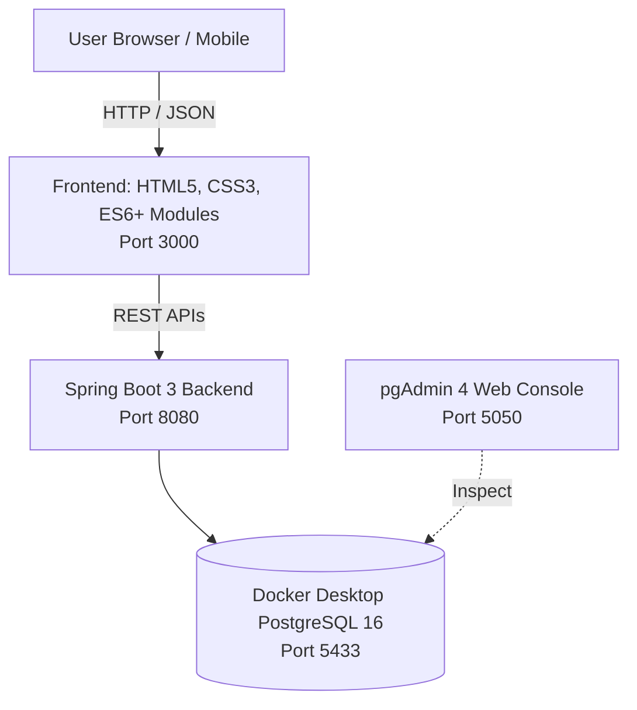

# FairShare Intelligence — Expense Splitter & Settlement Optimizer

**Presenter / Project Owner:** Tulsi and Kavya Verma
**Category:** Full-Stack Web Application  
**Evaluation Audience:** College Project Evaluation  
**Architecture:** Spring Boot 3 (Java 21/25 LTS) + Docker Desktop PostgreSQL 16 + Vanilla HTML5/CSS3/ES6+ UI  

---

## 1. Overview & System Architecture

**FairShare Intelligence** is a financial shared-expense management platform designed for student trips, flatmates, meals, and group activities. Beyond conventional splitters that merely log who owes whom, FairShare provides a transparent decision-support layer:

- **Fairness Simulator (Signature Feature):** Non-destructive split scenario preview comparing current allocations against proposed rules before persisting changes.
- **Settlement Optimizer (Signature Feature):** Dual-engine payment optimizer executing exact minimal-transfer search for small groups ($N \le 8$) and greedy heuristics for larger cohorts.
- **Explainable Activity History:** Audit trail logging balance changes with human-readable rationale derived directly from financial events.
- **Strict Monetary Invariants:** Zero floating-point arithmetic. All monetary values are strictly managed in **integer paise** (₹1 = 100 paise), enforcing $\sum \text{shares} = \text{total}$ and $\sum \text{netBalances} = 0$.



---

## 2. Technology Stack

| Layer | Technologies |
|---|---|
| **Frontend** | HTML5, CSS3 (Custom Design System: Dark Navy `#071827` & Emerald `#10B981`), Vanilla ES6+ JavaScript Modules |
| **Backend** | Java 21/25 LTS, Spring Boot 3.4.3, Spring Data JPA, Hibernate, Jakarta Bean Validation |
| **Database** | PostgreSQL 16 Alpine running in **Docker Desktop** via Docker Compose |
| **Testing** | JUnit 5, Spring Boot Test, H2 in-memory test database, Surefire |
| **Tooling** | Maven Wrapper (`mvnw`), Docker Desktop Engine, Git |

---

## 3. Quick Start & Execution Guide

### Prerequisites
- **Docker Desktop** installed and running
- **Java 21+** (or Java 25 LTS)
- **Git**

### Step 1: Clone and Configure Environment
```bash
git clone <repo-url>
cd Spliz
cp .env.example .env
```

### Step 2: Launch Database via Docker Desktop
```bash
docker compose up -d
```
* PostgreSQL is available on `localhost:5433` (Database: `fairshare_db`, User: `fairshare_user`).
* Optional pgAdmin 4 console is available at `http://localhost:5050` (`admin@fairshare.local` / `admin_secret`).

### Step 3: Run the Backend Server
```bash
cd backend
./mvnw spring-boot:run
```
* The backend starts on `http://localhost:8080`.
* On startup, deterministic sample evaluation data ("Goa Trip 2026") is automatically seeded if the database is clean.

### Step 4: Run the Frontend
```bash
# In the project root:
py -m http.server 3000 --directory frontend
```
* Open your browser at **`http://localhost:3000`**.

### Step 5: Execute Automated Test Suite
```bash
cd backend
./mvnw test
```
* Runs unit tests for equal, exact, and percentage split invariants, remainder distribution, and settlement optimization algorithms.

---

## 4. Key Endpoints Summary

| Method | Endpoint | Description |
|---|---|---|
| `GET` | `/api/groups` | List all groups |
| `POST` | `/api/groups` | Create new group |
| `GET` | `/api/groups/{id}/members` | List members in group |
| `POST` | `/api/groups/{id}/members` | Add member to group |
| `GET` | `/api/groups/{id}/expenses` | List group expenses and shares |
| `POST` | `/api/groups/{id}/expenses` | Record expense with split method |
| `GET` | `/api/groups/{id}/balances` | Get member net balances (Zero-sum verified) |
| `GET` | `/api/groups/{id}/settlements/suggestions` | Compute optimal transfer settlement plan |
| `POST` | `/api/groups/{id}/settlements` | Record confirmed payment between members |
| `POST` | `/api/expenses/{id}/preview-split` | Non-destructive split preview (Fairness Simulator) |
| `PUT` | `/api/expenses/{id}/apply-split` | Confirm and atomically apply simulated scenario |
| `GET` | `/api/groups/{id}/activity` | Fetch group activity audit trail |

---

## 5. Demonstration Flow for Evaluation

1. **Dashboard:** View "Goa Trip 2026" with 4 members (Rahul, Priyanshi, Amit, Sneha) and 3 recorded expenses.
2. **Balances & Invariants:** Inspect net balances:
   - Rahul: -₹200.00
   - Priyanshi: +₹1,400.00
   - Amit: +₹400.00
   - Sneha: -₹1,600.00
   - Invariant Check: Sum of net balances is exactly ₹0.00.
3. **Settlement Optimizer:** View the `EXACT_OPTIMAL` transfer plan (3 transfers to settle all 4 members).
4. **Fairness Simulator:** Select "Scuba Diving Tickets" (originally paid by Amit for Rahul, Priyanshi, Amit @ ₹1,000 each). Add Sneha as a participant. Observe instant non-mutating preview showing proposed share reduction to ₹750 each and individual delta calculations.
5. **Activity Log:** Inspect traceable historical events verifying transparent balance change explanations.
